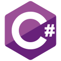

<h1 align="center">Hi, I'm Nyan Lin Htut 👋</h1>

Full-stack AI Software Engineer · 📍 Auckland, New Zealand

  
  

Full-stack AI Software Engineer based in Auckland, New Zealand. I build production-grade AI agents and full-stack applications — from real-time moderation systems to AI concierge platforms — and enjoy speaking at tech conferences about agentic AI and cloud architecture. Outside of code, I'm into cloud, data, music, and the occasional cooking video.

---

### 🤝 Trusted By

<table>
  <tr>
    <td align="center" valign="top" width="150"> <b>Wise Boys</b> Vegan Burger Restaurant, Auckland</td>
    <td align="center" valign="top" width="150"> <b>caster ZyZy</b> 834K subs</td>
    <td align="center" valign="top" width="150"> <b>BZTV</b> 459K subs</td>
    <td align="center" valign="top" width="150"> <b>Bo Kyar Channel</b> 557K subs</td>
    <td align="center" valign="top" width="150"> <b>The United Show</b> 421K subs</td>
  </tr>
</table>

---

### 💼 Works

<table>
  <tr>
    <td align="center" valign="top" width="280">
       
      <b>Moderator Agent</b> 
      Real-time AI moderation for YouTube live chat, running in production on channels with hundreds of thousands of subscribers.
    </td>
    <td align="center" valign="top" width="280">
       
      <b>Wise Boys</b> 
      End-to-end website migration & AWS/Cloudflare infrastructure for a famous Auckland vegan burger brand.
    </td>
    <td align="center" valign="top" width="280">
       
      <b>HostFlow AI</b> 
      AI guest concierge for hotels & short-term rentals, powered by a multi-agent pipeline on Google ADK & Gemini.
    </td>
  </tr>
  <tr>
    <td align="center" valign="top" width="280">
       
      <b>Melofy</b> 
      AI-powered smart playlist generator for Spotify based on your mood & taste.
    </td>
    <td align="center" valign="top" width="280">
       
      <b>Rain in the Kitchen</b> 
      My YouTube channel — cooking content.
    </td>
    <td valign="top" width="280"></td>
  </tr>
</table>

---

### 🎤 Tech Conference Speaking

<table>
  <tr>
    <td align="center" valign="top" width="400">
       
      <b>DevFest Singapore 2025</b> 
      Underrated features of Google AI Studio & Gemini Enterprise · Nov 22, 2025
    </td>
    <td align="center" valign="top" width="400">
       
      <b>Build with AI, GDG Kuala Lumpur</b> 
      Serverless Agents: Running AI Agents on Google Cloud Run · Apr 9, 2026
    </td>
  </tr>
  <tr>
    <td align="center" valign="top" width="400">
       
      <b>AWS Community Day Malaysia 2025</b> 
      Building Smarter AWS Agents with MCP & Bedrock AgentCore Gateway · Sep 27, 2025
    </td>
    <td align="center" valign="top" width="400">
       
      <b>Build with AI Workshop, GDG UPM</b> 
      Steering the Model: crafting better AI prompts · May 10, 2026
    </td>
  </tr>
</table>

---

### 📜 Certificates & Awards

<table>
  <tr>
    <td align="center" valign="top" width="280"> <b>AWS Certified Cloud Practitioner</b></td>
    <td align="center" valign="top" width="280"> <b>AWS Certified AI Practitioner</b></td>
    <td align="center" valign="top" width="280"> <b>AWS Certified Solutions Architect</b></td>
  </tr>
  <tr>
    <td align="center" valign="top" width="280"> <b>AI Agents in LangGraph</b> DeepLearning.AI</td>
    <td align="center" valign="top" width="280"> <b>LangChain for LLM App Dev</b> DeepLearning.AI</td>
    <td align="center" valign="top" width="280"> <b>JPMorgan Chase SWE</b> Work Simulation</td>
  </tr>
  <tr>
    <td align="center" valign="top" width="280"> <b>GrabFin Marketing Simulation</b></td>
    <td align="center" valign="top" width="280"> <b>Software Engineer Intern</b> HackerRank</td>
    <td align="center" valign="top" width="280"> <b>iOS & Swift Bootcamp</b> Udemy</td>
  </tr>
  <tr>
    <td align="center" valign="top" width="280"> <b>First Prize</b> Multidisciplinary Project Event, JCU</td>
    <td align="center" valign="top" width="280"> <b>Bachelor of IT</b> James Cook University</td>
    <td valign="top" width="280"></td>
  </tr>
</table>

---

### 🧰 Skills

<table>
  <tr>
    <td align="center" valign="top" width="160"> <b>C#</b></td>
    <td align="center" valign="top" width="160"> <b>.NET</b></td>
    <td align="center" valign="top" width="160"> <b>Java</b></td>
    <td align="center" valign="top" width="160"> <b>OOP</b></td>
    <td align="center" valign="top" width="160"> <b>TypeScript</b></td>
  </tr>
  <tr>
    <td align="center" valign="top" width="160"> <b>React</b></td>
    <td align="center" valign="top" width="160"> <b>Software Development</b></td>
    <td align="center" valign="top" width="160"> <b>Cloud</b></td>
    <td align="center" valign="top" width="160"> <b>AWS</b></td>
    <td align="center" valign="top" width="160"> <b>GCP</b></td>
  </tr>
  <tr>
    <td align="center" valign="top" width="160"> <b>Terraform</b></td>
    <td align="center" valign="top" width="160"> <b>Docker</b></td>
    <td align="center" valign="top" width="160"> <b>GitHub</b></td>
    <td align="center" valign="top" width="160"> <b>REST API</b></td>
    <td align="center" valign="top" width="160"> <b>SQL</b></td>
  </tr>
  <tr>
    <td align="center" valign="top" width="160"> <b>Kafka</b></td>
    <td align="center" valign="top" width="160"> <b>System Design</b></td>
    <td align="center" valign="top" width="160"> <b>Microservices</b></td>
    <td align="center" valign="top" width="160"> <b>Scrum</b></td>
    <td align="center" valign="top" width="160"> <b>Agile</b></td>
  </tr>
</table>

---

  

---

See the full interactive portfolio at <a href="https://nyanlinhtut.com">nyanlinhtut.com</a>

